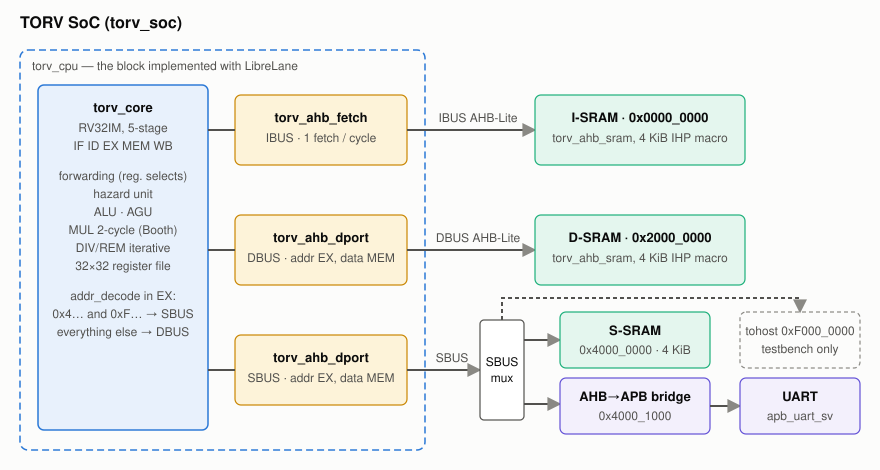
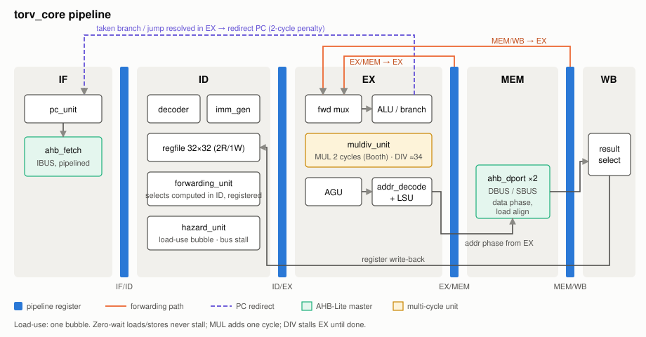
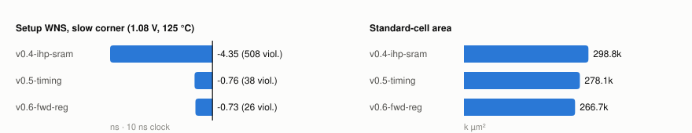
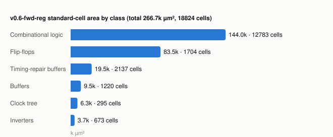
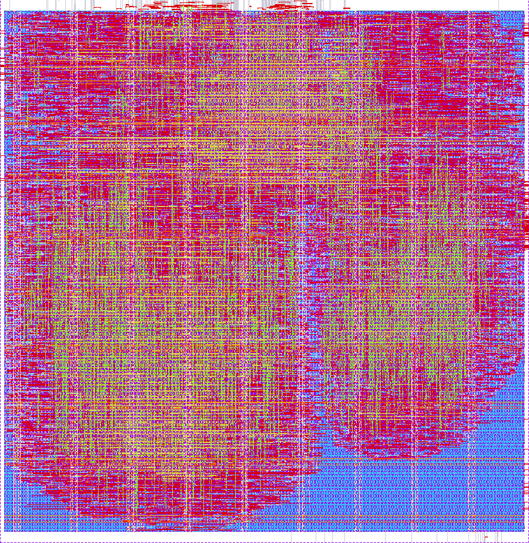
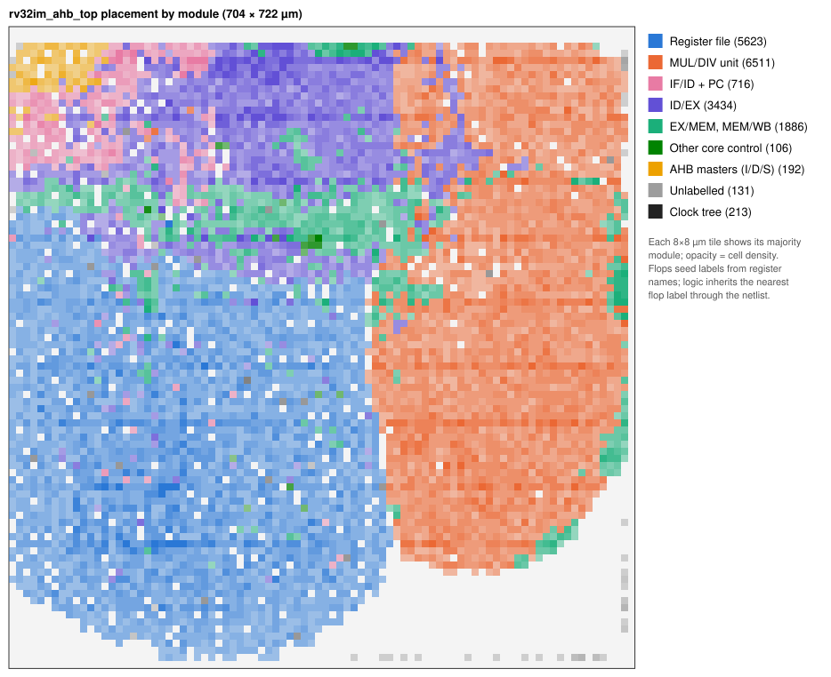
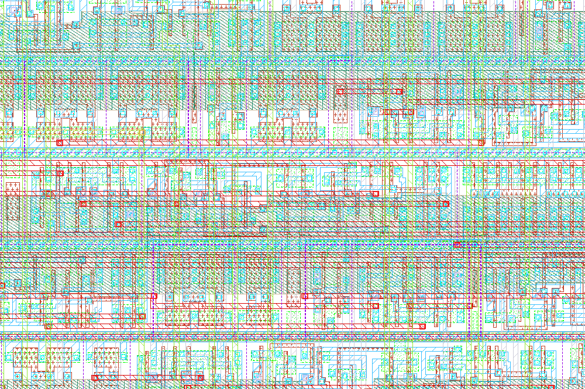

# rv32m

Open-source **RV32I + M-extension** five-stage in-order core and the **TORV** SoC
(**T**orino **O**pen **R**ISC-**V**), with a fully open-source flow from RTL to GDS:

- **Simulation:** Verilator + GTKWave, directed RISC-V assembly tests, self-checking
  testbench, regression and performance counters.
- **Physical implementation:** LibreLane (Yosys, OpenROAD, Magic, KLayout, Netgen) on the
  **IHP SG13G2** 130 nm open PDK, including the IHP SRAM macros.

No commercial EDA tool or proprietary PDK is needed. Step-by-step instructions are in
[docs/open_source_flow.md](docs/open_source_flow.md).

## Highlights

- **ISA:** RV32I (no CSRs, traps or C extension) + RV32M.
  - `MUL*`: two cycles (operand register + Booth multiplier).
  - `DIV`/`REM*`: iterative restoring divider (≈34 cycles); divide-by-zero and
    overflow results per the RISC-V spec.
- **Pipeline:** IF / ID / EX / MEM / WB with:
  - EX/MEM and MEM/WB forwarding (registered selects);
  - load-use bubble;
  - branches resolved in EX (2-cycle taken penalty);
  - a dedicated AGU for load/store addresses.
- **Buses:** Harvard core with three **pipelined AHB-Lite** masters:
  - **IBUS** — one fetch per cycle;
  - **DBUS / SBUS** — address phase in EX, data phase in MEM, so loads and stores to a
    zero-wait slave never stall.
- **TORV SoC (`torv_soc_top`):**
  - three IHP SG13G2 SRAM macros, 4 KiB each by default, behind the zero-wait wrapper
    `torv_ahb_sram`;
  - SoCBUS `AHB_APB_BRIDGE` and the PULP `apb_uart_sv` UART.
  - Address map: [docs/torv_address_map.md](docs/torv_address_map.md).
- **Verification:**
  - 33-case regression (`regress/cases/soc.list`) with pass/fail via a `tohost` store;
  - `[PERF]` counters per case and `perf_summary.csv` per run;
  - PC/WB trace checks for hazard cases.
- **Implementation:** `rv32im_ahb_top` closes DRC, LVS and antenna checks at 10 ns
  (results below).

## Architecture



The core is a Harvard machine with three AHB-Lite masters. `addr_decode` (in EX) sends
`0x4xxx_xxxx` and `0xFxxx_xxxx` to SBUS and everything else to DBUS. The dashed box is
`rv32im_ahb_top`, the block that goes through LibreLane. The SRAM macros, the SBUS mux,
the APB bridge and the UART sit at SoC level.



- **IF:** `pc_unit` and the pipelined fetch master; one instruction per cycle from a
  zero-wait slave.
- **ID:** decode, immediate generation, register-file read, and the hazard unit.
  - The forwarding selects for the next EX are computed here, from next-state pipeline
    values, and registered. EX therefore only drives the operand mux.
- **EX:**
  - operand forwarding (from EX/MEM and MEM/WB);
  - ALU and branch resolution (a taken branch or jump costs 2 cycles);
  - the multiply/divide unit;
  - the AGU, `addr_decode` and LSU, which issue the AHB address phase.
- **MEM:** the AHB data phase and load alignment. The MEM/WB result is selected before the
  register, so WB is a plain write.

Details: [spec/RV32IM_Current_Implementation.md](spec/RV32IM_Current_Implementation.md).

## Repository layout

| Path | Contents |
|------|----------|
| `rtl/` | Core (`rv32im_core` and its units), AHB masters (`rv32im_ahb_fetch`, `rv32im_ahb_dport`), `rv32im_ahb_top`, SoC (`torv_soc_top`, `torv_ahb_sram`), `filelist.f` |
| `sim/` | Testbench `tb_torv_soc.sv`, `Makefile` shortcuts, [SIM_README.md](sim/SIM_README.md) |
| `tests/core/asm/` | Directed assembly tests, `link.ld`, per-case `.plusargs` |
| `tests/periph/` | Peripheral tests (UART) |
| `regress/` | Regression driver and case lists ([README](regress/README.md)) |
| `scripts/` | `env.sh` environment, `run_case.sh`, `regress.sh`, Verilator build, waveform/trace/perf helpers |
| `ip/` | Third-party IP filelist; sources are fetched into `ip/third_party/` ([README](ip/README.md)) |
| `librelane/` | LibreLane config, SDC, `Makefile` (`synth`, `flow`, `figures`), `qor.py`, `figures/` (layout and QoR plot scripts) |
| `spec/` | [RV32IM_Current_Implementation.md](spec/RV32IM_Current_Implementation.md) — microarchitecture reference |
| `docs/` | Open-source flow, address map, loading, TODO, changelog, bug notes; `img/` holds the README figures |

## Prerequisites

The versions below are tested (Ubuntu 24.04, also under WSL2):

| Tool | Version | Used for |
|------|---------|----------|
| Verilator | 5.020 (≥ 5.0 with `--timing`) | Simulation |
| `gcc-riscv64-unknown-elf` | 13.2 | Assembling tests (`-march=rv32im -mabi=ilp32`) |
| GTKWave | 3.3 | Waveforms (optional) |
| Python 3, `curl`, `make`, `g++` | — | Scripts, IP fetch, Verilator C++ build |
| IHP SG13G2 PDK | via `ciel` (LibreLane) | SRAM simulation models, implementation |
| LibreLane | 3.0.16 (Python venv + Docker) | Synthesis, place & route, signoff (optional) |

Ubuntu packages:

```bash
sudo apt install verilator gcc-riscv64-unknown-elf gtkwave python3 python3-venv make g++ curl
```

The IHP PDK is needed **for simulation as well**, because the SoC SRAMs use the PDK's
`RM_IHPSG13_1P_*` functional models. Install LibreLane and the PDK as described in
[docs/open_source_flow.md](docs/open_source_flow.md#1-install-the-tools). The default
`PDK_ROOT` is `~/.ciel`.

## Quick start

```bash
git clone https://github.com/panlong-1/rv32m.git
cd rv32m
source scripts/env.sh                        # paths, PATH, PDK_ROOT; prints what it found

./scripts/run_case.sh tests/core/asm/smoke.S     # one test (fetches third-party IP on first run)
./scripts/regress.sh                             # full regression: 33 cases

./scripts/run_case.sh --vcd tests/core/asm/smoke.S
./scripts/open_gtkwave.sh smoke                  # waves

make -C librelane                                # IHP synthesis + pre-PnR STA (minutes)
make -C librelane flow                           # full RTL-to-GDS + signoff (~1-1.5 h)
```

## Environment

`scripts/env.sh` is the single place for paths. It:

- sets `TORV_ROOT`, `PROJECT_ROOT` (the repo's parent) and `PDK_ROOT`;
- picks the RISC-V toolchain: `$PROJECT_ROOT/riscv_toolchain/bin` if present, otherwise
  `/usr/bin`;
- puts `scripts/` and the toolchain on `PATH`.

After a case runs, `t` changes directory to its build folder. `source regress/env.sh` does
the same setup from anywhere in the tree.

| Variable | Default | Purpose |
|----------|---------|---------|
| `TORV_RISCV_TOOLCHAIN_BIN` | `$PROJECT_ROOT/riscv_toolchain/bin` or `/usr/bin` | Directory holding `${PREFIX}gcc` |
| `TORV_RISCV_GNU_PREFIX` | `riscv64-unknown-elf-` | Toolchain prefix |
| `TORV_VERILATOR` / `TORV_VERILATOR_BIN_DIR` | `verilator` / — | Verilator binary / extra `PATH` entry |
| `TORV_GTKWAVE` | `gtkwave` | GTKWave binary |
| `PDK_ROOT` | `~/.ciel` | IHP SG13G2 PDK (SRAM models, LibreLane) |
| `LIBRELANE_VENV` | `~/.venv/librelane` | LibreLane Python venv |

To override paths without editing tracked files, copy `scripts/env.local.sh.example` to
`scripts/env.local.sh`. That copy is gitignored and is sourced after the defaults.

## Simulation

```bash
./scripts/run_case.sh tests/core/asm/loadstore.S               # one case → build/sim/soc/loadstore/
./scripts/run_case.sh --vcd tests/core/asm/hazard.S            # + hazard.vcd
./scripts/run_case.sh --pc-trace tests/core/asm/smoke.S        # + pc_trace.tsv (PC and WB columns)
./scripts/run_case.sh --max-cycles 50000 tests/core/asm/muldiv.S
TORV_KEEP_BUILD=1 ./scripts/run_case.sh tests/core/asm/smoke.S   # keep the existing build dir
```

- Each case directory holds the ELF, HEX, disassembly (`.dump`), `<case>.sim.log`, the
  Verilator build (`verilator/obj_dir`) and an optional VCD / PC trace.
- Tests end by storing to `tohost` at `0xF000_0000`: `1` means PASS, anything else FAIL.
  `max_cycles` is only a watchdog.
- `sim/Makefile` offers the same commands as shortcuts, e.g. `make -C sim run CASE=smoke VCD=1`,
  `make -C sim regress`, `make -C sim gtkwave CASE=smoke`.

Details: [sim/SIM_README.md](sim/SIM_README.md), [docs/loading.md](docs/loading.md),
[tests/core/README.md](tests/core/README.md).

## Regression and performance

```bash
./scripts/regress.sh                                        # regress/cases/soc.list (33 cases)
./scripts/regress.sh --case alu --case muldiv
./scripts/regress.sh --case-list regress/cases/deep_hazard.list
./scripts/regress.sh --waves --pc-trace
./scripts/check_hazard_dup_trace.py --case hazard_ibus_insn_dup --run
./scripts/perf_summary.py regress/results/<stamp> --csv perf.csv
```

Results go to `regress/results/<stamp>/`:
- `summary.rpt`;
- per-case directories;
- `perf_summary.csv`, with cycles, instructions, IPC, instruction mix, stall/flush counts and
  bus transfers.

Representative cycle counts (v0.6):

| Case | Cycles | IPC |
|------|--------|-----|
| `perf_alu_chain` | 777 | 0.835 |
| `perf_loadstore_loop` | 330 | 0.709 |
| `perf_branch_loop` | 648 | 0.605 |
| `perf_mul_loop` | 122 | 0.607 |

## Physical implementation (IHP SG13G2, LibreLane)

The implemented block is `rv32im_ahb_top`: the core plus its three AHB-Lite masters. The SoC
SRAM macros and peripherals are not part of this block.

- Configuration: [librelane/config.yaml](librelane/config.yaml).
  - Synthesis: slang frontend, ABC buffering, Booth multiplier.
  - Implementation: post-global-route timing repair.
  - Clock period: 10 ns.
- Constraints: [librelane/constraints.sdc](librelane/constraints.sdc) — 2 ns input/output
  delay budget, 0.3 ns setup uncertainty.

```bash
make -C librelane                       # synth + pre-PnR STA → runs/synth
make -C librelane flow                  # full flow → runs/flow (GDS, signoff)
make -C librelane flow CLOCK_PERIOD=12.5 TAG=p12
make -C librelane qor TAG=flow          # re-print a run's QoR
make -C librelane figures               # layout PNGs, placement map, QoR charts → docs/img
```

### Results at 10 ns (v0.6 RTL, unchanged in v0.7)

| Area and layout | Value |
|-----------------|-------|
| Die | 703.6 × 722.4 µm = 0.508 mm² |
| Std-cell area / utilization | 266.7k µm² / 55.7% |
| Std cells (excl. fill/tap) | 18,824, of which 1,704 flip-flops |
| Clock tree | 213 buffers + 82 inverters; setup skew 0.34 ns |
| Timing repair | 2,137 resizer buffers, 276 setup buffers, 10 hold buffers |
| Routing | 1.01 m of wire, 134,525 vias, 0 DRC after 6 detailed-route iterations |
| Antenna | 12 diodes inserted, 0 violating nets |
| Power-grid IR drop | 7.9 mV worst (VPWR), 0.17 mV average |
| Power (estimate) | 13.7 mW: 11.2 mW internal, 2.5 mW switching, 15 µW leakage (default activity, not from simulation) |

| Timing and signoff | Value |
|--------------------|-------|
| Setup WNS — typ 1.20 V / 25 °C | +2.35 ns |
| Setup WNS — fast 1.32 V / −40 °C | +4.12 ns |
| Setup WNS — slow 1.08 V / 125 °C | **−0.73 ns**, TNS −7.85 ns, 26 endpoints (24 register → AHB address/control outputs, 2 register-to-register at −0.08 ns) |
| Hold | met at all corners (worst +0.10 ns) |
| Magic / KLayout DRC, Netgen LVS, XOR, antenna | clean |

At the slow corner, the block runs at about 93 MHz under the 2 ns output-delay budget.
[docs/TODO_LIST.md](docs/TODO_LIST.md) lists the remaining paths and the options for
closing them.





### Layout

<table>
<tr>
<td width="50%"></td>
<td width="50%"></td>
</tr>
<tr>
<td>Final GDS (KLayout, IHP layer colours), 704 × 722 µm.</td>
<td>Where each module's cells are placed.</td>
</tr>
</table>

How the placement map is built:

- After synthesis the netlist is flat, so flip-flops keep their RTL register names but
  logic cells do not.
- Each flip-flop is labelled from its register name.
- Each logic cell takes the label of the nearest labelled flip-flop through the netlist,
  so the boundaries are approximate.

What the map shows:

- The register file (bottom left) and the multiplier/divider (right) take most of the
  area.
- The pipeline registers and the AHB masters sit along the top edge, where most of the I/O
  pins are.



*A 24 × 16 µm window at the die centre: standard-cell rows, metal routing and power
rails.*

## Version history

Each step is a tag on the main branch. `git checkout <tag>` or `git diff <tag-a> <tag-b>` shows
the exact change.

| Tag | Change |
|-----|--------|
| `v0.1-baseline` | Baseline before bus pipelining and the IHP flow (IPC ≈ 0.2) |
| `v0.2-ibus-pipe` | Pipelined AHB-Lite instruction fetch (IPC up to ≈ 0.8) |
| `v0.3-dbus-pipe` | Pipelined DBUS/SBUS: zero-wait loads and stores |
| `v0.4-ihp-sram` | SoC memories on IHP SG13G2 SRAM macros (zero-wait wrapper) |
| `v0.5-timing` | Slow-corner timing: AGU, two-cycle MUL, Booth, post-GRT repair |
| `v0.6-fwd-reg` | Registered forwarding selects, pre-selected MEM/WB result |
| `v0.7-open-flow` | Open-source-only repository, `make -C librelane flow`, documentation refresh |

`docs/changelog/` contains the session notes.

## Documentation

- [docs/open_source_flow.md](docs/open_source_flow.md) — install the tools; simulation →
  regression → synthesis → RTL-to-GDS → viewing results.
- [spec/RV32IM_Current_Implementation.md](spec/RV32IM_Current_Implementation.md) —
  microarchitecture (pipeline, hazards, buses, SoC).
- [docs/torv_address_map.md](docs/torv_address_map.md) — address map.
- [rtl/TORV.md](rtl/TORV.md) — SoC overview.
- [sim/SIM_README.md](sim/SIM_README.md) — simulation reference.
- [regress/README.md](regress/README.md) — regression.
- [docs/loading.md](docs/loading.md) — program loading.
- [tests/core/README.md](tests/core/README.md), [tests/periph/README.md](tests/periph/README.md) — tests.
- [ip/README.md](ip/README.md) — third-party IP.
- [docs/TODO_LIST.md](docs/TODO_LIST.md) — open items.

## License

[MIT](LICENSE). Third-party IP fetched into `ip/third_party/` keeps its own license
([ip/README.md](ip/README.md)).
